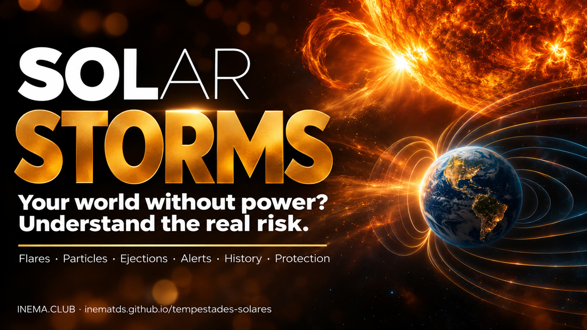

# Solar storms

**[Português](README.md) · [English](README.en.md) · [Español](README.es.md)**

## What it is

Nei’s independent educational videos about solar phenomena and their effects on infrastructure. For anyone who wants to interpret NOAA alerts, learn about the history, and prepare their family for service outages. Just watch or read. The headlines are educational hypotheticals; they do not announce a worldwide blackout or a date.

## Watch and download

- [Page with the videos and explanations](https://inematds.github.io/tempestades-solares/guia/en/)
- [Full HD MP4, SRT captions, and covers](https://github.com/inematds/tempestades-solares/releases/tag/videos-v1.1.0)
- [Manifest with file size and SHA-256](videos/manifest.json)

The videos are in Portuguese: impact (1 min 42 s), reading NOAA alerts (2 min 07 s), and history/protection (8 min 11 s). The first two are available in 16:9 and 9:16 formats; the longer one is 16:9. Each video stands alone.

## Repository contents

- `conteudo/`: scripts, sources, credits, and production checks.
- `assets/`: illustrations, reference images, and dashboard screenshots.
- `producao/`: historical scripts that depend on the INEMA environment.
- `guia/`: access page in Portuguese, English, and Spanish. Videos and screenshots remain in their original language.
- `videos/`: file manifest; large MP4s are in Releases.

## Sources and reuse

NOAA/SWPC, National Weather Service, USGS, NASA, and SpaceWeatherLive. Full credits are in [FONTES-E-CREDITOS.txt](conteudo/FONTES-E-CREDITOS.txt). Third-party media retain their own terms of use. No general permission for all images is implied. Free educational content: https://inema.club.
