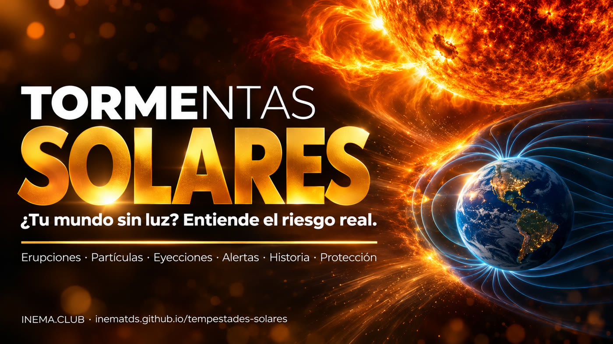

# Tormentas solares

**[Português](README.md) · [English](README.en.md) · [Español](README.es.md)**

## Qué es

Videos educativos independientes de Nei sobre los fenómenos solares y sus efectos en la infraestructura. Para quienes quieren interpretar las alertas de la NOAA, conocer la historia y preparar a su familia para interrupciones de servicios. Basta con ver o leer. Los mensajes son hipótesis educativas; no anuncian un apagón mundial ni una fecha.

## Ver y descargar

- [Página con los videos y las explicaciones](https://inematds.github.io/tempestades-solares/guia/es/)
- [MP4 Full HD, subtítulos SRT y portadas](https://github.com/inematds/tempestades-solares/releases/tag/videos-v1.1.0)
- [Manifiesto con tamaño y SHA-256](videos/manifest.json)

Los videos están en portugués: impacto (1 min 42 s), interpretación de la NOAA (2 min 07 s) e historia/protección (8 min 11 s). Los dos primeros están en formatos 16:9 y 9:16; el largo está en 16:9. Cada video funciona por sí solo.

## Contenido del repositorio

- `conteudo/`: guiones, fuentes, créditos y verificaciones de la producción.
- `assets/`: ilustraciones, imágenes de referencia y capturas de los paneles.
- `producao/`: scripts históricos, dependientes del entorno INEMA.
- `guia/`: página de acceso en portugués, inglés y español. Los videos y las capturas se mantienen en el idioma original.
- `videos/`: manifiesto de los archivos; los MP4 grandes están en los Releases.

## Fuentes y reutilización

NOAA/SWPC, National Weather Service, USGS, NASA y SpaceWeatherLive. Los créditos completos están en [FONTES-E-CREDITOS.txt](conteudo/FONTES-E-CREDITOS.txt). Los medios de terceros mantienen sus propias condiciones de uso. No se implica una autorización general para todas las imágenes. Contenido educativo gratuito: https://inema.club.
