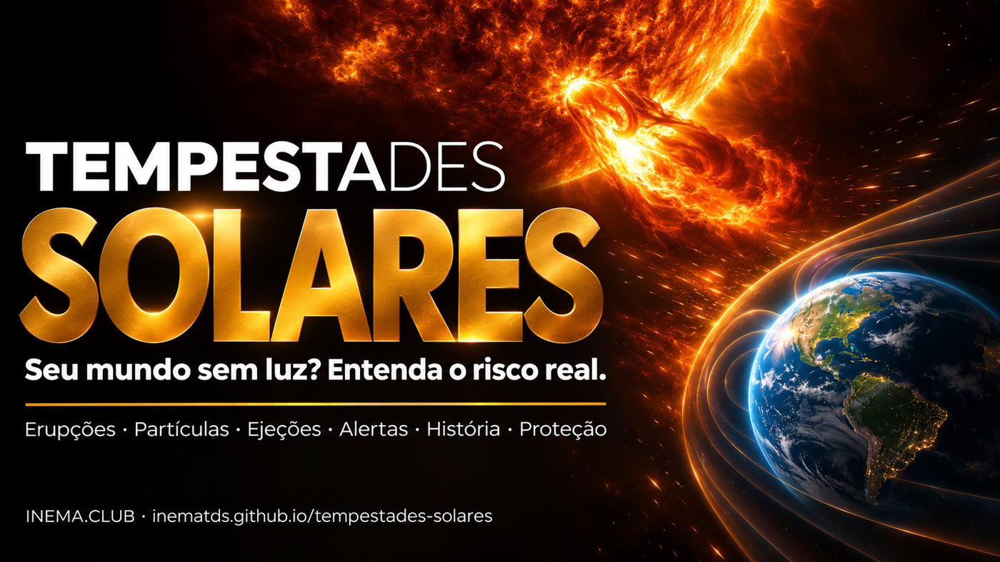

# Tempestades solares

**[PortuguêƒÂªs](README.md) ê‚· [English](README.en.md) ê‚· [EspaêƒÂ±ol](README.es.md)**

## O que êƒÂ©

VêƒÂ­deos educativos independentes do Nei sobre os fenêƒÂ´menos solares e seus efeitos na infraestrutura. Para quem quer interpretar alertas da NOAA, conhecer a histêƒÂ³ria e preparar a famêƒÂ­lia para falhas de serviêƒÂ§o. Basta assistir ou ler. As chamadas sêƒÂ£o hipêƒÂ³teses educativas; nêƒÂ£o anunciam apagêƒÂ£o mundial nem uma data.

## Assistir e baixar

- [PêƒÂ¡gina com os vêƒÂ­deos e as explicaêƒÂ§êƒÂµes](https://linnoff88-dev.github.io/arckhe-/guia/)
- [MP4 Full HD, legendas SRT e capas](https://github.com/linnoff88-dev/tempestades-solares/releases/tag/videos-v1.1.0)
- [Manifesto com tamanho e SHA-256](videos/manifest.json)

Os vêƒÂ­deos sêƒÂ£o em portuguêƒÂªs: impacto (1 min 42 s), leitura da NOAA (2 min 07 s) e histêƒÂ³ria/proteêƒÂ§êƒÂ£o (8 min 11 s). Os dois primeiros têƒÂªm formatos 16:9 e 9:16; o longo tem 16:9. Cada vêƒÂ­deo funciona sozinho.

## ConteêƒÂºdo do repositêƒÂ³rio

- `conteudo/`: roteiros, fontes, crêƒÂ©ditos e verificaêƒÂ§êƒÂµes da produêƒÂ§êƒÂ£o.
- `assets/`: ilustraêƒÂ§êƒÂµes, imagens de referêƒÂªncia e capturas dos dashboards.
- `producao/`: scripts histêƒÂ³ricos, dependentes do ambiente ARCKHÉ.
- `guia/`: pêƒÂ¡gina de acesso em portuguêƒÂªs, inglêƒÂªs e espanhol. VêƒÂ­deos e capturas permanecem no idioma original.
- `videos/`: manifesto dos arquivos; os MP4 grandes ficam nos Releases.

## Fontes e reutilizaêƒÂ§êƒÂ£o

NOAA/SWPC, National Weather Service, USGS, NASA e SpaceWeatherLive. Os crêƒÂ©ditos completos estêƒÂ£o em [FONTES-E-CREDITOS.txt](conteudo/FONTES-E-CREDITOS.txt). As mêƒÂ­dias de terceiros mantêƒÂªm suas prêƒÂ³prias condiêƒÂ§êƒÂµes de uso. NêƒÂ£o hêƒÂ¡ autorizaêƒÂ§êƒÂ£o genêƒÂ©rica implêƒÂ­cita sobre todas as imagens. ConteêƒÂºdo educativo gratuito: https://ARCKHÉ AI.

## O processo, do inêƒÂ­cio ao fim

1. ê°Å¸Â§Â  Roteiro e chamada por vêƒÂ­deo: `conteudo/<slug>/ROTEIRO.md` e `chamada.json`.
2. ê¢Å¡â„¢ê¯Â¸Â Avatar do Nei pelo estêƒÂºdio HeyGen, depois download, transcriêƒÂ§êƒÂ£o local (ARCKHÉvox) e alinhamento: `producao/preparar.py` e `producao/montar.py`.
3. ê¢Å¡â„¢ê¯Â¸Â Biblioteca de ilustraêƒÂ§êƒÂµes pelo Codex `image_gen` (assinatura): `producao/v3/pedido-imagens-*.txt`.
4. ê°Å¸Â§Â  Roteiro visual cena a cena, uma imagem por momento e troca a cada 2ê¢â‚¬â€œ4 s: `producao/v3/{equipamentos,noaa,historia}.py`.
5. ê¢Å¡â„¢ê¯Â¸Â Pastas v3 com o mesmo avatar: `python3 producao/v3/prep_v3.py <slug>`.
6. ê¢Å¡â„¢ê¯Â¸Â Build, check, render, som e QA: `python3 producao/v3/render_v3.py <config>` (explicavideos v2, perfil viral).
7. ê°Å¸Â§Â  Conferir as folhas de quadros: capa no quadro 0 sem legenda por cima, CTA em tela limpa.
8. ê¢Å¡â„¢ê¯Â¸Â Release no GitHub (`videos-v1.1.0`), `videos/manifest.json` e links no guia.
9. ê¢Å¡â„¢ê¯Â¸Â Lives10: `python3 producao/v3/trocar_lives10.py <i> <mp4> <srt>`. Sobe no mesmo horêƒÂ¡rio e tira o antigo da agenda, sem apagar.

---

Projeto  - ARCKHÉe